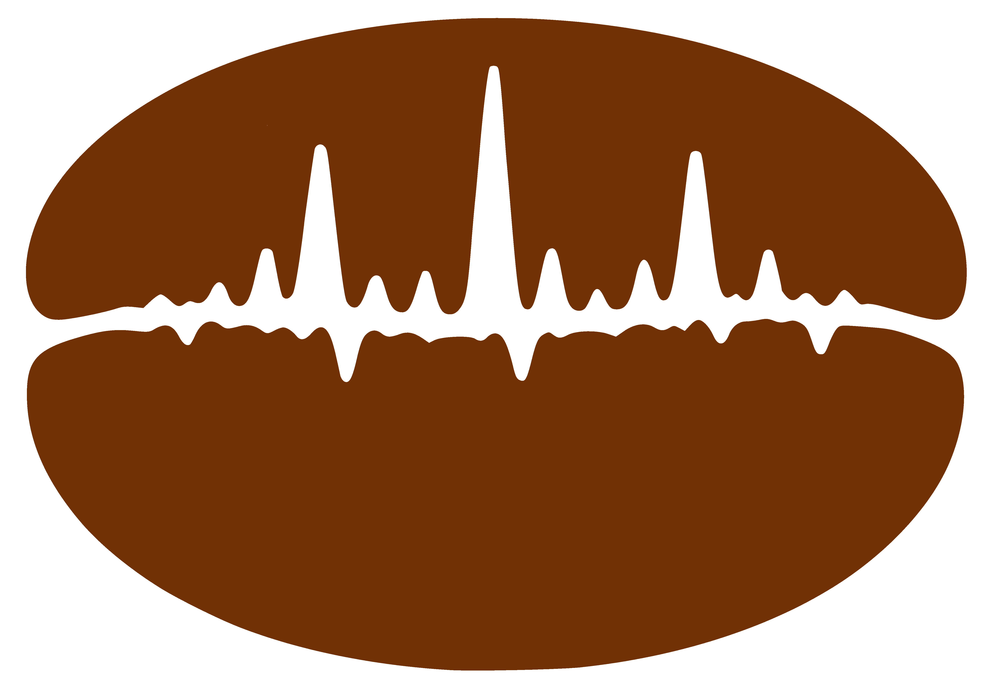
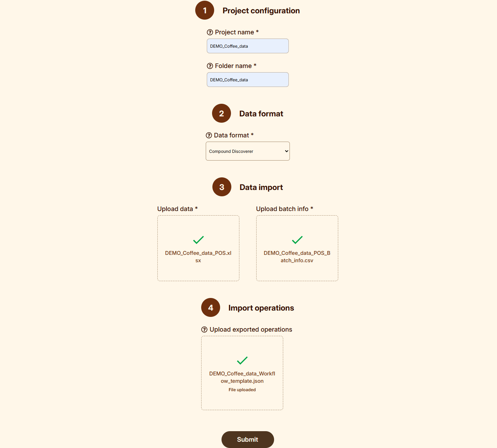
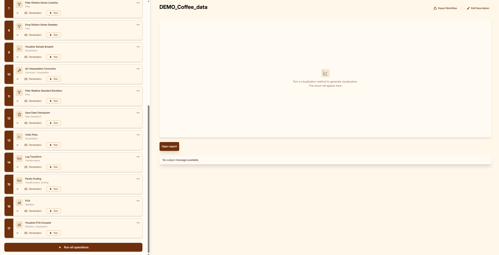
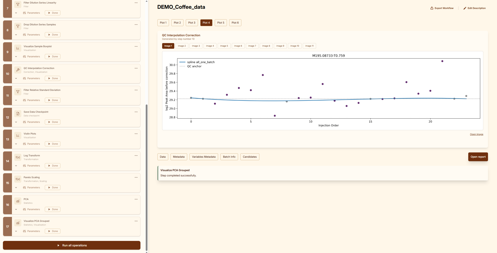
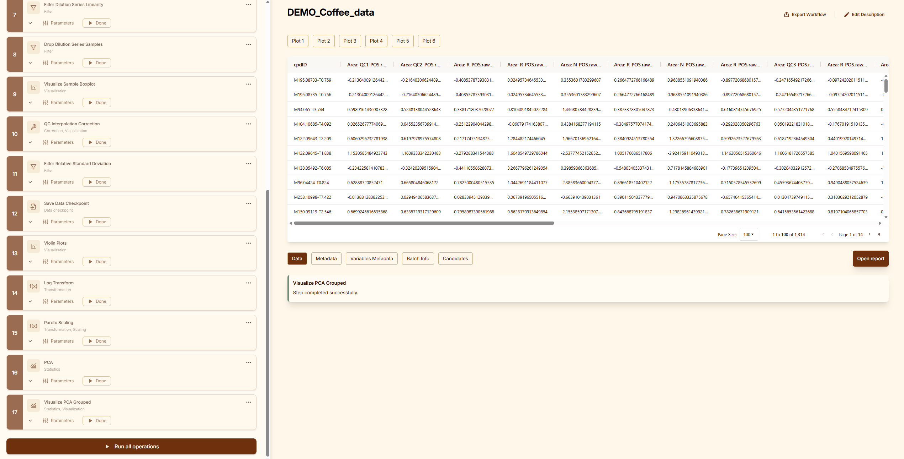
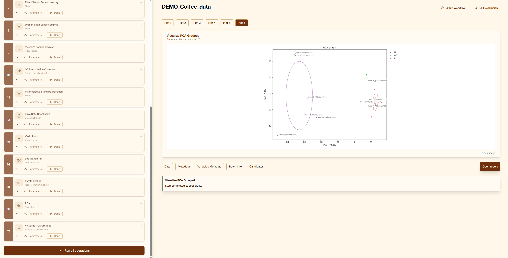
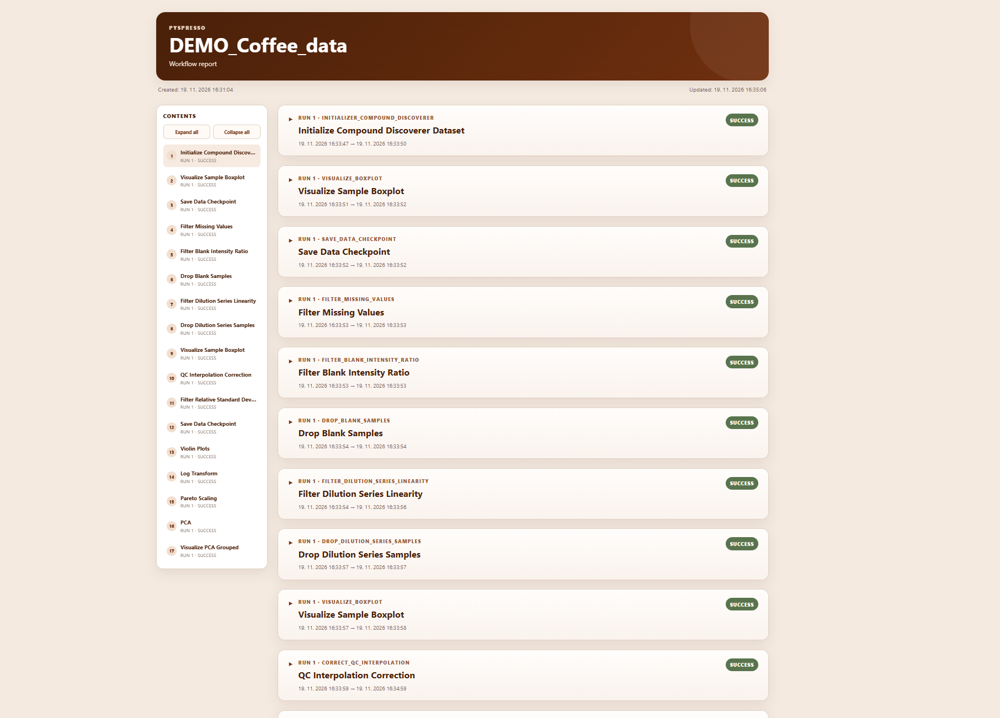

<h1>
  Example workflow - Coffee data
  
</h1>
PySPRESSO’s development began with coffee data, which partly inspired
its name. This tutorial returns to those roots with a simplified dataset
of roasted and nonroasted coffee beans. Many samples and compounds were
removed from the original dataset to create a smaller demonstration
dataset; it does not represent the complete study.

The tutorial covers data import, quality filtering, QC-based correction,
transformation, scaling and principal component analysis (PCA).

> [!TIP]
> Before starting, follow the
> [README instructions](https://github.com/Najlaron/PySPRESSO/blob/PySPRESSO-GUI/README.md)
> to install and launch PySPRESSO. Once the application is open in your
> browser, continue below.

## 1. Download the demo files ☕

Download these three files from the repository’s `demo` folder:

- [Data table](../demo/DEMO_Coffee_data_POS.xlsx)
- [Batch information and sample metadata](../demo/DEMO_Coffee_data_POS_Batch_info.csv)
- [Workflow template](../demo/DEMO_Coffee_data_Workflow_template.json)

The data include roasted coffee samples (`R`), nonroasted coffee samples
(`N`), quality-control samples (`QC`), blanks and a dilution series.
The `Coffee Type` metadata column identifies the groups used in the
visualizations.

The workflow template contains the operations and parameter settings
used in this tutorial, so you do not need to add each operation manually.

> [!NOTE]
> These settings illustrate processing of this demonstration dataset.
> Review them before applying the workflow to another study.

## 2. Create the project and import the workflow ☕

On the home page, click **Get Started**, then **Create new workflow**.

Enter a project name and folder name, such as `DEMO_Coffee_data`, and
select **Compound Discoverer** as the data format.

Upload the three downloaded files into the corresponding fields:

| Field | File |
|---|---|
| Upload data | `DEMO_Coffee_data_POS.xlsx` |
| Upload batch info | `DEMO_Coffee_data_POS_Batch_info.csv` |
| Upload exported operations | `DEMO_Coffee_data_Workflow_template.json` |

Once all three files are selected, click **Submit**.

## 3. Review and run the workflow ☕

The imported operations appear in the left sidebar. Click **Parameters**
on an operation to inspect its settings.

The workflow first initializes the dataset and creates an initial
boxplot and data checkpoint. It then filters compounds using missing
values, blank intensity ratios and dilution-series linearity. Blank and
dilution-series samples are removed after their respective filtering
steps.

QC-based correction and filtering by relative standard deviation follow.
The remaining operations save a processed-data checkpoint, generate
violin plots, apply log transformation and Pareto scaling, and perform
PCA.

For this first run, keep the imported settings and click
**Run all operations** at the bottom of the sidebar. Alternatively,
run the operations individually in their listed order to inspect
intermediate results.

Completed operations are marked **Done**. If an operation fails,
check the message below the results area before continuing.

## 4. Inspect the processing results ☕

Use the **Plot** tabs above the results area to switch between outputs
from different operations. When an operation produces several images,
use its **Image** tabs to browse them.

For example, select the output from **QC Interpolation Correction**.
Its plots show measurements across injection order and allow you to
inspect the fitted correction and the results before and after correction.
The screenshot below shows one of the plots before correction.

Use **Open image** to inspect a figure at a larger size. Below the
results area, the **Data**, **Metadata**, **Variables Metadata**,
**Batch Info** and **Candidates** buttons provide access to the
corresponding tables.

In our reference run, processing reduced the dataset from **3,066 to
1,314 compounds**. After removing blanks and dilution-series samples,
**24 sample columns** remained: 18 coffee samples and six QC samples.
The report records how many compounds or samples were removed at
each step.

## 5. Explore the PCA results ☕

The final operations apply log2 transformation and Pareto scaling,
calculate PCA and display the samples coloured by `Coffee Type`.

Select the output from **Visualize PCA Grouped** to inspect the
distribution of roasted (`R`), nonroasted (`N`) and QC samples.

In this example, the roasted and nonroasted samples separate mainly
along the first principal component. The QC samples form a compact group.
Use the plot to explore group patterns and samples that differ from
others in the same group.

> [!NOTE]
> Roasting substantially changes the chemical composition of coffee beans.
> The clear separation in this demo should therefore not be taken as
> typical of clinical metabolomics data, where differences between groups
> may be more subtle and individual variation greater.

## 6. Review the report and reuse the workflow ☕

Click **Open report** to view the HTML report. Use its contents panel
to navigate between operations and expand an entry to inspect its
parameters, messages, tables and figures.

The report brings the processing steps and their outputs together,
making it easier to review what was done and identify steps that may
need adjustment.

The template includes **Save Data Checkpoint** operations before
processing and after QC-based correction and filtering. These preserve
data at those stages for later use.

If you adapt the workflow, use **Export Workflow** in the upper-right
corner of the workflow page to save its operations and parameter
settings as a reusable template. A template can be imported when
creating another project; it does not replace the input data files.

To extend the workflow with your own methods, see
[Creating custom operations](custom-operations.md) and
[Creating operations with AI assistance](AI-assisted-operations.md).
